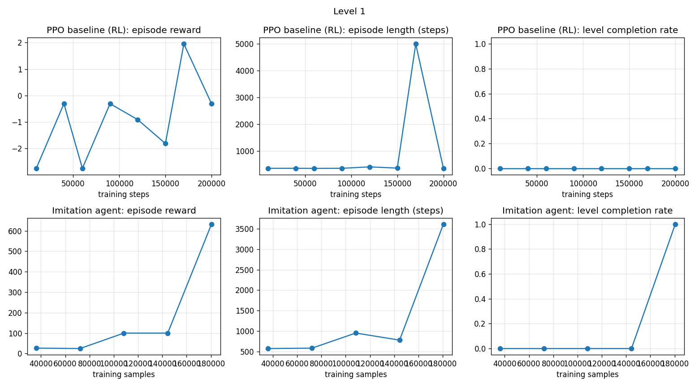

# Legend of Prince Valiant (NES): an agent that clears Levels 1–3

This repo trains agents that clear the first three levels of *Legend of Prince Valiant* on the NES, using
[stable-retro](https://github.com/Farama-Foundation/stable-retro) and [Stable-Baselines3](https://github.com/DLR-RM/stable-baselines3).

I started with PPO from pixels. It never got through a level, so the final agents use **search + imitation**:
1. A savestate search finds one route that clears the level.
2. A PPO CnnPolicy network learns to play that route from the screen (behaviour cloning).

📄 **Report:** [`report/Report_Prince_Valiant_RL.pdf`](report/Report_Prince_Valiant_RL.pdf)
🎬 **Video:** `clips/progress_video_all.mp4` (or link: _add your video link here_)

---

## Results

10 evaluation episodes per test. Level 1 starts from the game's normal start; Levels 2 and 3 start from the first frame of
that level. Task goal: at least 7/10 with deterministic actions.

| Test | Level 1 | Level 2 | Level 3 |
|---|---|---|---|
| **Deterministic** | **10/10** | **10/10** | **10/10** |
| Temperature 0.1 | 8/10 | 10/10 | 10/10 |
| Temperature 0.5 | 3/10 | 10/10 | 10/10 |
| Shifted start (0–30 random no-ops) | 0/10 | 0/10 | 0/10 |
| PPO baseline (200k steps) | 0/10 | 0/10 | not run |

**Honest limit:** each agent has learned one route very well. If the start is shifted a few frames, it fails.

<p align="center">
  <br>
  <em>Level 1: PPO (top) never clears; imitation (bottom) clears at epoch 50.</em>
</p>

---

## Quick start (Google Colab)

1. Zip this repo as `pvrl_code.zip` and put it, `colab_run.ipynb` and your own legally owned `.nes` ROM in a Google Drive folder
   (the notebook uses `/content/drive/MyDrive/RL_TASK_L1_2`; change `WORK` in the first cell if yours is different).
2. Open `colab_run.ipynb` in Colab and run the cells from top to bottom.

It trains everything from scratch (PPO baselines + imitation for Levels 1–3), evaluates, draws the graphs and makes the video.

## Run locally

```bash
pip install -r requirements.txt
mkdir roms && cp /path/to/your/rom.nes roms/      # ROM not included
python -m stable_retro.import roms/
```

| Step | Level 1 | Level 2 | Level 3 |
|---|---|---|---|
| PPO baseline | `python train.py --steps 200000 --envs 8 --seed 0 --out runs/ppo_baseline` | `python train_l2.py --steps 200000 --envs 8 --seed 0 --out runs/l2_ppo` | – |
| Route | included: `optional_demo/demo_level1_full.json` | `python tools/aim_route_l2.py` | included: `optional_demo/demo_level3_route.json` |
| Imitation | `python bc_exact.py --demos optional_demo/demo_level1_full.json --out runs/v5 --seed 0` | `python bc_exact_l2.py --demo runs/search_l2/level2_clear_aim.json --out runs/l2_v1 --seed 0` | `python bc_exact_l3.py --demo optional_demo/demo_level3_route.json --out runs/l3_v1 --seed 0` |
| Evaluate | `python eval.py --model runs/v5/final.zip --episodes 10` | `python eval.py --model runs/l2_v1/final.zip --level 2 --episodes 10` | `python eval.py --model runs/l3_v1/final.zip --level 3 --episodes 10` |

Extra eval options: `--temperature 0.1` (sampled actions), `--noop 30` (shifted start).

Graphs and video:
```bash
python make_graphs.py                                   # report/graph_level1-3.png, graph_ppo_entropy.png
python make_video_all.py --out clips/progress_video_all.mp4
```

---

## How it works

| Part | Details |
|---|---|
| Observation | frame skip 4, grayscale, 84×84, 4 stacked frames (+1 channel with the step number for imitation) |
| Actions | Level 1: 10 · Level 2: 19 (aim × fire + cover) · Level 3: 12 |
| Game state | position, room/section, lives, timer, boss health and quest flags read from RAM |
| PPO | 8 envs, n_steps 256, batch 256, lr 2.5e-4 (linear decay), clip 0.1, entropy 0.02, γ 0.99 |
| Imitation | same CnnPolicy, Adam 1e-3, batch 128; checks the real game every 10 epochs and stops when the level is cleared |
| Rules | lives, timer and invincibility are never changed; no level skips; savestates only for training and route search |

The routes were found once with a savestate search (`tools/go_explore*.py`, `tools/segments_l3.py`, several hours on CPU).
They are included in `optional_demo/`, so you don't have to run the search again.

## Repository layout

```
pv/                  game environments (Level 1, 2, 3) and helpers
tools/               route search (Go-Explore style) and Level 2 aim-assist route
optional_demo/       the routes used for imitation
states/              save states at the start of Level 2 and Level 3
train.py, train_l2.py                        PPO baselines
bc_exact.py, bc_exact_l2.py, bc_exact_l3.py  imitation training
eval.py              10-episode evaluation
make_graphs.py       reward / length / completion / entropy graphs
make_video*.py       progress videos
colab_run.ipynb      full pipeline on Google Colab
report/              report (PDF + Word) and the script that builds it
runs/                checkpoints, TensorBoard logs, eval results (created by training)
```

## Hardware and versions

Google Colab: AMD EPYC 9B45 (48 cores), 176 GB RAM, NVIDIA RTX PRO 6000.
Python 3.13 · stable-retro 1.0.1 · stable-baselines3 2.9.0 · gymnasium 1.4.0 · torch 2.11 · seed 0 everywhere.
Imitation training: 0.7 / 1.1 / 2.3 min for Levels 1 / 2 / 3.

The ROM is not included. Use your own legally owned copy.
